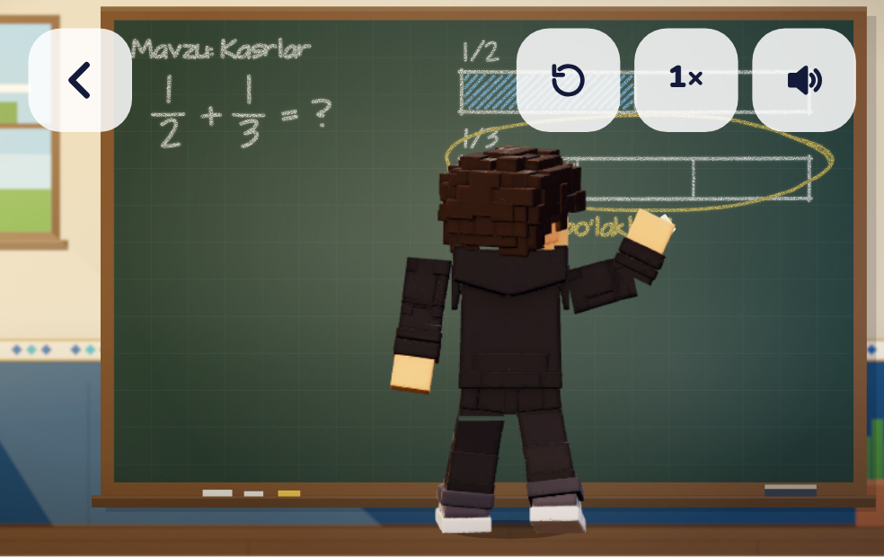
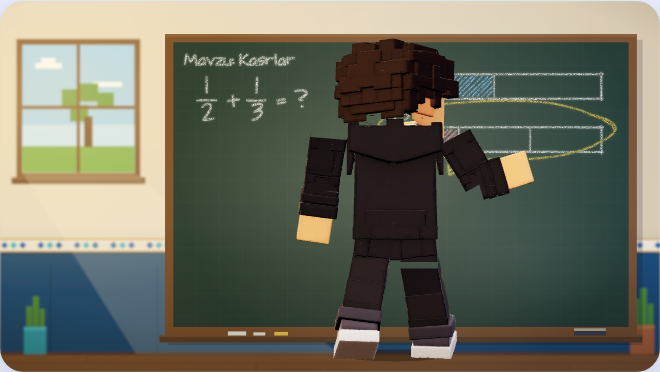
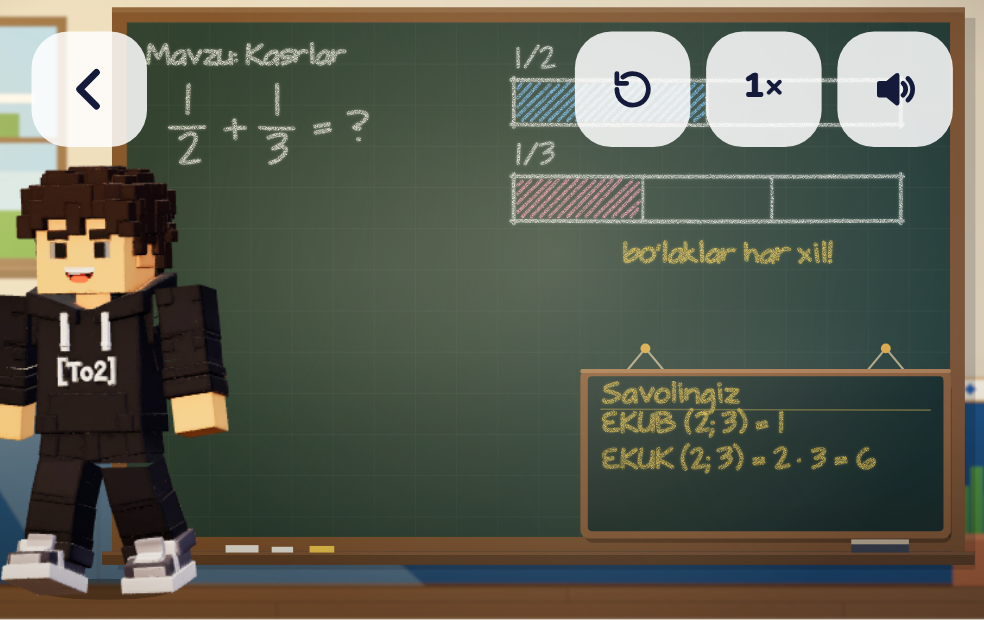
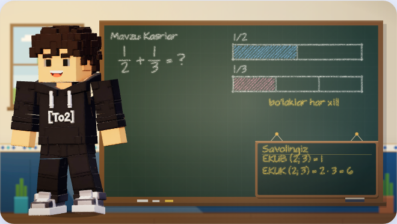
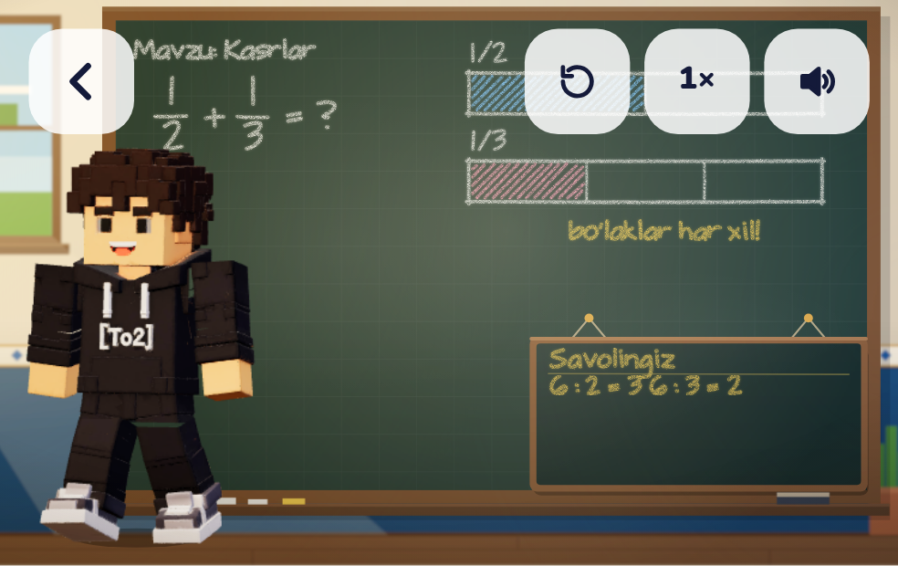
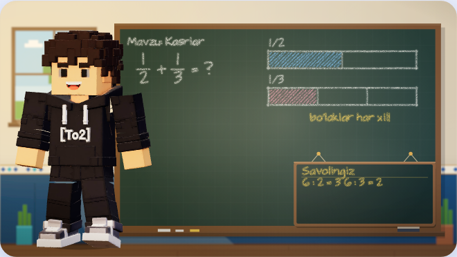
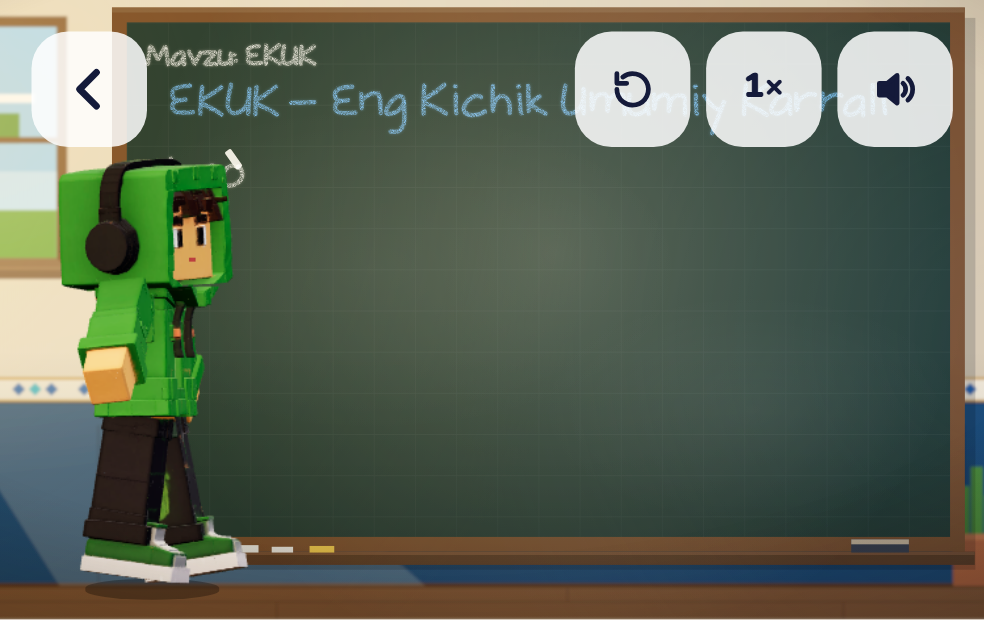
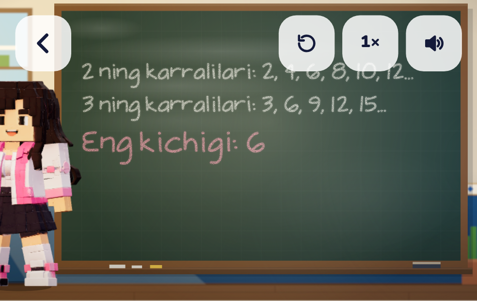
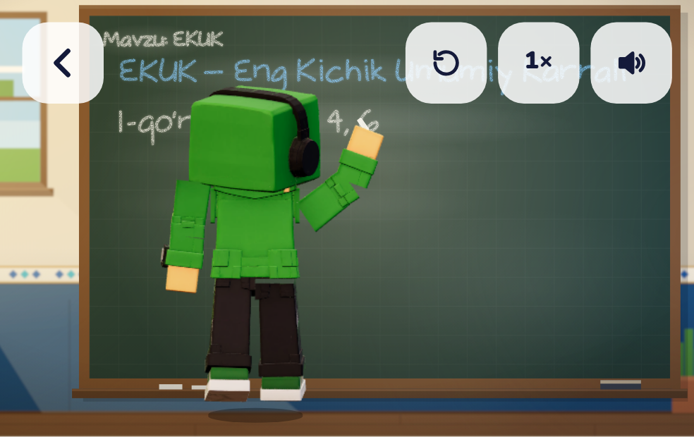

# REPORT — agent build log

**Live URL:** https://to2.locallabs-io.workers.dev  ·  Repo: `origin/main`

## Final summary (17 Nov 2026)

**What works (live, real VoiceLab):**
- Landing → onboarding (1 tap with defaults) → adaptive diagnostic (8 q.) → personal roadmap (list + React Flow graph) → lesson → practice → profile. Teacher panel `/teacher` (sample data) for task #4.
- Lesson: Blokbek/Robo-Rayhon/Agent Shox/Chaqmoq speak Uzbek (VoiceLab TTS) while the chalkboard draws in sync; captions always shown; answers checked by mathjs; XP, streak, confetti.
- **Barge-in:** mic (push-to-talk, Space on desktop) or typed question → lesson freezes → VoiceLab STT → LLM answer streamed as SSE segments → drawn in an orange note panel + highlights → *Davom et* resumes at the exact audio position / chalk command; *Yana tushuntir* re-explains more simply.
- Verified live: STT transcribed a VoiceLab Uzbek clip exactly ("Nega maxrajlarni ko'paytirdik?", ~4 s); LLM interrupt answer ~6–10 s uncached, ~2 s cached; LLM lesson first segment ~7 s then ~1 s per segment; TTS ~0.8–2.8 s uncached, cached afterwards.
- 29 vitest tests (player state machine, mastery, roadmap, diagnostic, answer checker, board parser/model, demo lessons, generators for all 47 skills).

**How to run locally:** see README (`pnpm install`, copy `.dev.vars.example`, `pnpm dev`). `MOCK_AI=1` → fully offline demo (no voice, captions + timers).

**What is mocked / simplified:**
- `MOCK_AI=1` mode only (production uses real VoiceLab).
- Teacher panel uses generated sample class data (labelled "Namuna ma'lumot").
- The 4 core lessons (fractions, 2-step equation, percentages, rectangle area) are hand-written and served instantly; other skills are LLM-generated (cached 7 days) with a canned fallback.

**Demo script (CLAUDE.md §15) — prepared:**
1. Phone → landing → *Boshlash* → grade 6 + Blokbek (pre-selected) → *Diagnostikani boshlash*.
2. Diagnostic starts with *1/2 + 1/4*; answer it wrong, the rest right → roadmap: *Maxrajlari har xil kasrlarni qo'shish* = **Hozir · Zaif nuqta**.
3. *Darsni davom ettirish* → *Darsni boshlash* → Blokbek explains 1/2 + 1/3 with fraction bars (voice pre-cached).
4. Hold mic: *"Nega maxrajlarni ko'paytirdik?"* → filler "Yaxshi savol!…" → cached answer + voice (pre-warmed by `scripts/warm-tts.mjs`).
5. Answer the 3 in-lesson questions (6, 2, 3/4) → lesson done → *Mashqqa o'tish* → one correct practice answer → node turns green (0.4 → 0.55 → 0.66 → 0.75 → lesson finish 0.81 → practice 0.86).
6. Same URL on tablet/laptop.
- Before the demo: run `node scripts/warm-tts.mjs` once (idempotent) and do a dry run on the demo phone (mic permission prompt!).

## ★ Design update — re-skin + voxel tutors (17 Nov, evening) ✅
Per CLAUDE.md "★ Design update" and `docs/prototypes/`:
- **App UI = `mobile-app.html`**: light lavender/white, blue primary `#2f6bff`, Nunito 700–900, white cards r22, bottom tabs **Bosh sahifa · Darslar · Progress · Sozlamalar** (sidebar on ≥768 px). All 8 prototype screens exist: splash `/`, home `/home`, lesson `/lesson/[id]`, tutors `/tutors`, progress `/progress`, quiz style in `/diagnostic` + `/practice/[id]`, "A'lo!" success screen, settings `/settings`. Onboarding, roadmap (list + React Flow), teacher and privacy re-skinned.
- **8 voxel tutors** (Blokbek, Agent Shox, Lola, Ziyo, Sardor, Ravshan, Diyorbek, Shadow) from `makeChar(cfg)`, ported to TypeScript for three.js r180 (`src/components/characters/voxel.ts`). Free: Blokbek, Agent Shox, Lola · 200/300/400/500 XP · Shadow = 7-day streak. Each has its own VoiceLab voice (Lola female: *Safiya*).
- **Portraits:** `/characters/<id>_<pose>_<frame>.png` if listed in `src/config/characterRenders.json` (generated at build from `public/characters/`), else an in-browser three.js render. The team's 144 Blender renders were picked up automatically; the build also writes WebP copies (3.6 MB vs 28 MB PNG) served via `<picture>`.
- **Lesson stage** = `board-handwriting.html` ported: classroom SVG + chalkboard + live 3D tutor (`TutorCanvas`) who faces the learner while talking, turns his back and walks along the board while writing, right arm follows the chalk tip with 2-bone IK, bends for low rows, lip-syncs from the real TTS amplitude, leans in while listening, hand-to-chin while thinking, cheers on correct answers. Phones get a board-focused crop with a 0.75× tutor.
- **Handwriting engine** (`src/components/board/handwriting.ts`): every board command becomes single-line chalk strokes revealed at hand speed in writing order; per-glyph ±3° / 0.96–1.04 / baseline jitter; fractions stacked by hand; fraction bars shaded with chalk hatching; chalk SVG filter; chalk piece at the tip; chalk-circle highlights; erase = wipe-out. New §5b ops: `strike`, `arrow` (point or target), `tick`, `divider`, `wipe`, `circle{target}`. Writing starts 300 ms after speech. No typeset math on the board any more.
- "Savol berish" = push-to-talk (hold, or tap-to-toggle, Space on desktop) + keyboard; barge-in engine unchanged.
- Backend, engine, VoiceLab, learning logic: unchanged (35 vitest tests).
- **Fix found in the demo run:** an LLM interruption answer contained `erase`, which wiped the main explanation. The board model now lets the note layer erase only its own notes (regression test added).
- Demo re-run on live (phone viewport): splash → onboarding → diagnostic (exact demo path, "A'lo!" at the end) → roadmap shows *Maxrajlari har xil kasrlarni qo'shish* as Hozir · Zaif nuqta → lesson starts, the typed "Nega maxrajlarni ko'paytirdik?" interrupt is answered in ~2.5 s from cache → 3 answers + lesson finish + 1 practice answer → node **O'zlashtirildi** (0.40 → 0.86). TTS warmed for all 8 tutors (149 phrases, 0 failures).
- ⚠️ The final visual pass of the lesson's interrupt → "Davom et" on live could not be completed: the Browser pane was hidden, which pauses `requestAnimationFrame` (the chalk timeline). It was verified earlier on localhost (desktop + phone). **Re-run steps 4–6 on a real phone before judging**, including the mic.
- ⚠️ If the learner switches apps mid-lesson the chalk timeline pauses until the tab is visible again (rAF), by design.
- Team files committed as found: `public/characters/` (144 Blender renders + `blender/` sources, ~51 MB) and `tools/blender/to2_characters.py`.

## 🐞 Tutor bugs (all subjects) — 2026-11-18, branch `feat/subjects-2`, NOT deployed, 0 credits
| Bug | Cause found | Fix | Proof |
|---|---|---|---|
| 1. "Same answer every time" | (a) pinned matching accepted ≥ 80 % word overlap → look-alike questions could get the demo answer; (b) cache key had no subject (topic lessons only differed by skill id); (c) offline/mock answers were the same "maxraj" explanation for almost any question; (d) a rate-limited lesson silently served the NEAREST skill's demo lesson | (a) strong match only: every question word (polite words aside) must be in the alias + ≥ 85 % overlap; (b) key `int:v4:<subject>:<skill>:…:<hash(skill+question)>`; (c) mock names the question + says it is offline; (d) only the skill's own demo, else canned, `meta.reason` = rate-limited/mock | `src/app/api/tutor/route.test.ts`: 3 different questions → 3 different answers (maths + fizika), repeat = cache, same question in another subject ≠ cached, demo question still pinned |
| 2. Silent live answers | the engine already waits for slow voice with fillers; no 4 s cut in the current path | wait exactly **12 s** (`VOICE_WAIT_MS`) for every line (lesson + live), think pose + bubble status **"o'ylayapman…"** (`voiceWait`), then captions-only | not unit-tested (engine has no test harness) |
| 3. Restart replays on the side board | restart phrases the client didn't recognise ("darsni qayta boshla", "yangidan", "takrorla", "restart") went to the LLM → answered on the side slate | `isRestartRequest` recognises them → `restartLesson()` (main board, side slate cleared) | `intents.test.ts` +7 restart / +2 real-question cases |
| 4. Tutor in front of the text / toolbar over the heading | he stood a fixed 45 % of reach left of the chalk tip (on the line he just wrote); lessons didn't reserve the phone's toolbar/back-button bands | he stands left of the element's left edge, as far as the arm still reaches (90 %) — `standGoal()`; lesson layouter reserves toolbar (top-right) + back button (top-left); "Mavzu: …" title right of the back button, ≤ 18 chars | animator test (beside / max reach); screenshot `docs/screenshots/subjects/7-title-below-toolbar-tutor-beside.jpg` |
- **Physics question bank for the games** `src/data/questions.fizika.ts`: 27 hand-written questions (3 per skill) as
  `{id, skillId, question, choices, answer, hint}` + `PHYSICS_BANK` in feat/games' `Bank` shape (skillId → generators → `{q, hint, expect:{kind:"choice"}}`). Tested: answer ∈ choices, checker accepts right / rejects wrong.
- Tests 215 green, build green. ⚠️ Known: writing that starts at the board's far-left edge can still be partly covered on phones
  (the stage edge clamps him); the interrupt cache keys changed (v3 → v4), so old cached live answers are regenerated once.

## 📚 Subjects: Fizika + "Istalgan mavzu" (2026-11-18, branch `feat/subjects-2`, NOT deployed)
Judges' feedback: "not only math". The same board + tutor engine now teaches other subjects.
- **Subjects config** `src/config/subjects.ts`: id, name, icon, colours, status (live/beta/soon), skill-graph file, tutor role,
  prompt **flavour**, Uzbek terms, allowed board ops. Matematika = default (a skill without `subject` is maths). The old
  maths topic tiles moved to `src/config/mathTopics.ts` (roadmap filters unchanged).
- **Prompt** (`src/lib/ai/prompts/tutor.uz.ts`): persona/flavour/terms/board ops come from the skill's subject (lesson +
  interrupt); fizika uses the Tezlik lesson as few-shot; maths prompt unchanged in content.
- **FIZIKA (7-sinf)**: `src/data/skills.fizika.uz.json` — 9 skills (masofa-vaqt → tezlik → o'rtacha tezlik; massa → zichlik;
  massa → kuch → bosim; kuch + masofa → ish → quvvat). Page `/fan/fizika` (prerequisites first). Kept OUT of the maths graph
  (diagnostic, roadmap, practice generators untouched).
- **Pinned demo lesson** `fiz-tezlik` (`src/lib/ai/mock/physics.ts`): car (box + wheels) + motion arrow, distance line, s/t
  definitions, handwritten `v = s/t` fraction, units (km/soat, m/s), two worked examples (120 km / 2 soat = 60; 45 / 3 = 15).
  Other physics skills = LLM lessons with the physics flavour.
- **Istalgan mavzu (Beta)**: home field "Qaysi mavzuni o'rganmoqchisiz?" (text or mic → STT) → `/lesson/t:<topic>` → LLM board
  lesson, 5–6 segments, one choice question, Uzbek. Guardrails: client+server `cleanTopic()` (3–80 chars, letters only, blocklist),
  prompt refuses non-school/unsafe topics with a fixed line, no mastery/XP rows for topics. Mock mode: Fotosintez example only.
- **Home**: tiles Matematika · Fizika · Istalgan mavzu (Beta) · Kimyo/Biologiya/Ingliz tili = "Tez orada" (no link, no content).
- **Audio**: `scripts/warm-physics.mjs` (dry-run first) — 11 lines × Blokbek/Lola/Ziyo = 33; 31 generated (lison-v2, ok=31, fail=0,
  v1-fallback=0), dry-run price ≈ **3,546 credits** (budget 6,000). Re-check: 0 uncached.
- Tests: `src/config/subjects.test.ts` (+13: config loading, physics DAG/no cycles, demo lesson valid + answers, prompt has the
  subject flavour, topic guard). 208 unit tests green; `pnpm build` green. Screenshots 375×812: `docs/screenshots/subjects/`.
### Decisions (autonomy mode)
- Another session had `feat/subjects` checked out (same task) → built in this worktree on **`feat/subjects-2`** (user's choice).
- Topic id = `t:<topic text>` so every existing route works unchanged (skillId limit 64 → 128).
- Physics/topic lessons: no practice button (no generators yet) → "Fizika: boshqa mavzular" / "Bosh sahifa".
- Example 2 of the Tezlik lesson is written in the right column (the layouter re-places rewritten lines; this is stable).
### Known issues
- Tutor greeting before a lesson is still maths-flavoured ("Matematikani blokma-blok quramiz!") — per-subject greetings need audio.
- The real-LLM "Istalgan mavzu" path was not run end-to-end (no key in this worktree; production runs main). Prompt + guard are
  unit-tested; run one topic on staging after merge. LLM lessons for other physics skills: same caveat.
- Topic lessons show the topic twice on the board ("Mavzu: X" + the LLM's own title). `bytes.test.ts` CPU-timing test is flaky
  under load (passes alone).

## ❓ Unclear / assumption — design update
- What: repo `docs/prototypes/*.html` were older than the attached versions (repo `board-handwriting.html` had no `makeChar`). - I assumed: the attached files are current and copied them over. - To change: replace the files.
- Letters: single-stroke glyphs from **EMS Tech** (SIL OFL, via the MIT `hersheytext` package, extracted to `src/components/board/glyphs.json` by `pnpm glyphs`). It reads like teacher handwriting; the prototype's own glyph table covered only ~15 characters.
- Subjects on the home screen map to our curriculum sections (`src/config/subjects.ts`): Algebra, Geometriya, Funksiyalar, Kasrlar, Sonlar (+ "Tez orada: Fizika"). The prototype's "Ehtimollar" has no skills in our graph yet.
- Old characters Robo-Rayhon and Chaqmoq were replaced by the new roster; existing users with them fall back to Blokbek.
- three.js r180 instead of the prototype's r128 (colour management on, lights ×π to match).
- Pose `sig` exists in the Blender set but isn't used by the UI yet.

## Board auto-layout hardening (geo-perimeter) ✅
Team added `src/lib/board/layout.ts` (main-layer auto-layout on the server). Re-running the live geo-perimeter lesson found gaps; fixed and covered by tests on **three real LLM lessons** saved in `src/lib/board/__fixtures__/` (checked against the real chalk strokes, not boxes):
- a handwritten line wider than the board (1055 px) is stepped down l → m → s instead of being left on top of other writing;
- only short labels ("5 sm") stick to a shape; full lines of text next to a shape are their own row;
- labels that cut into their shape — including triangle sides drawn as `line`s — are nudged just outside;
- a rect/circle counts as an annotation only if it surrounds content; lines meeting end-to-end are a polygon (a new diagram), unless they trace an existing shape's outline;
- annotations are matched in the LLM's own coordinates and follow their target when the layout moves it (perimeter lines stay on the rectangle);
- a segment's anchored annotations are obstacles for the rest of that segment.
- ⚠️ The LLM's coordinates collide often, so the layout moves most drawings (15–20 of ~21 per lesson). Readable, but the board may not look exactly as the prompt intended.
- Deploy: `scripts/deploy.mjs` now skips `public/models/raw/`, `public/characters/blender/` and `_*.png` (source art; `models/raw/blokbek.glb` is 61 MB, over Cloudflare's 25 MiB asset limit).
- Push identity pinned: `origin` push URL is `https://LinusIp@github.com/LinusIp/To2.git` (Git Credential Manager only holds LinusIp).

## 🔑 Team must provide / decide
- [x] VoiceLab key — `.dev.vars` (local) + Wrangler secret on Worker `to2`.
- [x] Base URL `https://api.voicelab.uz`, language `uz`, model `aisha-gemma-4` (from docs + live API).
- [ ] **Listen to the 4 voices** and change if needed (`cloudflare.config.ts` → `VOICE_IDS`; current picks below).
- [ ] **Enable R2** in the Cloudflare dashboard (account returned code 10042). Then `pnpm wrangler r2 bucket create to2-audio` and uncomment `AUDIO` in `cloudflare.config.ts`. Until then TTS audio is cached in KV (works fine, 60-day TTL).
- [ ] Real numbers for `docs/pitch/business.md` (students, tutor prices, VoiceLab TTS/STT prices) — all marked `TODO(team)`.
- [ ] Lawyer review of `docs/pitch/legal.md` and `/maxfiylik`; teacher review of the skill graph.
- [ ] Optional: `npx cf auth login` so `pnpm deploy:cf` (official vinext deploy) works; today `pnpm deploy` uses wrangler.

## ⚠️ Known issues
- STT is async (job + polling) → ~3–4 s after releasing the mic. VoiceLab has a realtime WebSocket STT (stretch).
- Uncached LLM answers take 6–10 s; we cover the gap with a spoken filler and a thinking character; repeated questions are cached.
- The preview pane used for testing blocks the microphone, so push-to-talk was verified via the STT API round-trip and typed questions, not a physical mic. **Do a real-phone mic test before the demo.**
- The answer key for practice/lesson questions is sent to the client (needed for offline checking); fine for a hackathon, not for graded tests.
- vinext prints `INEFFECTIVE_DYNAMIC_IMPORT` / sourcemap warnings during build — harmless.
- shadcn/ui was not installed: the chunky block UI from the mockups is built directly with Tailwind (see assumption below).
- A teammate's prototype `docs/prototypes/board-handwriting.html` (hand-written chalk) was committed as-is; not wired in.

## Log

### M0 — scaffold ✅
- vinext 1.4 (Next 16 App Router API on Vite 8) via `pnpm create cloudflare --framework=next`, Tailwind v4 tokens, Drizzle schema + `drizzle/0000_init.sql`, D1 `to2` + KV created, deployed.

### M1 — board ✅
- zod contract (`src/lib/ai/schema.ts`), board model (apply / schedule / bbox / fit / note layout), SVG renderer (rough.js strokes with dash-offset animation, chalk fractions, KaTeX fallback, number line, fraction bar, plot via mathjs, highlight), 4 hand-written demo lessons.

### M2 — characters + TTS ✅
- 4 layered pixel-SVG characters (Blokbek + Agent Shox from the mockups; Robo-Rayhon + Chaqmoq new, original): bob, blink, mouth from Web Audio amplitude, pointing arm, thinking, celebrate + block confetti. `/api/tts` with cache.

### M3 — real AI loop ✅
- STT (async job polling), LLM streaming with incremental JSON segment extraction, zod per segment, retry → canned fallback, barge-in state machine + engine, KV caches, filler phrase.

### M4 — learning engine ✅
- 47-skill graph, generators for every skill, BKT-lite mastery, adaptive diagnostic, roadmap (list + React Flow/dagre).

### M5 — screens ✅
- Landing, onboarding, diagnostic, roadmap, lesson, practice, profile (collection, unlocks, badges, reset), privacy; mobile bottom tabs, tablet rail, desktop sidebar + mini roadmap.

### M6 — hardening ✅ (partly)
- Fallbacks everywhere, Uzbek error messages, rate limits (KV), TTS/LLM warm-up script, final deploy. Not done: automated e2e run of the demo 3× on a physical phone.

### M7 — stretch
- ✅ `/teacher` heatmap + one-click printable practice set (sample data). ❌ parent report, Telegram login, stylus scratchpad, Russian UI.

## ❓ Unclear / assumption — M0: config format
- What: C3 now scaffolds **`cloudflare.config.ts`** (new `cf` CLI config) instead of `wrangler.jsonc`, and `vinext-cloudflare deploy` uses the `cf` login (not logged in here; `wrangler` is).
- I assumed: keep `cloudflare.config.ts` as the source of truth; `pnpm deploy` = `vite build` + `scripts/deploy.mjs` (converts the build's `worker.config.json` → `.cloudflare/deploy/wrangler.json` → `wrangler deploy`).
- To change: after `npx cf auth login`, use `pnpm deploy:cf`.

## ❓ Unclear / assumption — M0: migrations
- What: no `wrangler.jsonc` to drive `wrangler d1 migrations apply`.
- I assumed: `src/db/client.ts` runs idempotent `CREATE TABLE IF NOT EXISTS` (mirrors `drizzle/0000_init.sql`) once per isolate; `pnpm db:migrate:remote` applies the SQL explicitly.
- To change: switch to `wrangler d1 migrations apply` if a wrangler config is adopted.

## ❓ Unclear / assumption — VoiceLab (verified against docs.voicelab.uz + live API)
- Auth `Authorization: Bearer vlk_…`, base `https://api.voicelab.uz/v1`. SDK not used (plain fetch, small bundle).
- TTS `POST /v1/tts` `{text, language:"uz", voice_id}` → WAV 24 kHz; **no word timestamps → proportional sync rule** (CLAUDE.md §3).
- STT `POST /v1/stt` multipart (`audio`, `language=uz`, UUID `Idempotency-Key`) → always 202 → poll `/v1/stt/transcriptions/{id}`.
- LLM `POST /v1/chat/completions` (OpenAI-compatible, SSE streaming). Models on our key: `aisha-gemma-4` (chosen: fast, `reasoning` off by default), `aisha-orbit`, `aisha-halo`, `aisha-muon`. No documented JSON mode → prompt + few-shot + zod; it follows the format well. Requesting `aisha-comet` silently served `aisha-gemma-4`.
- Voices: Blokbek → *Javohir — Bright presenter*; Agent Shox → *Rustam — Anime hero*; Robo-Rayhon → *Gulnoza*; Chaqmoq → *Botir — Bomba streamer*.

## ❓ Unclear / assumption — design
- What: the newer team mockups in `docs/mockups/` (Onboarding, Diagnostic) use a dark navy palette with Fredoka/Manrope, while CLAUDE.md §10 tokens (paper/ink/gold, Pixelify/Nunito/Kalam) match the lesson/roadmap mockups.
- I assumed: CLAUDE.md tokens everywhere (one consistent look); took the newer UX ideas (bridge progress, "Bilmayman — keyin birga quramiz", no-penalty note, locked-tutor silhouettes, "Ovozini eshit").
- To change: tokens are in `src/app/globals.css` `@theme`.
- shadcn/ui not installed — the mockups' chunky block style is simpler to build with plain Tailwind classes (`.btn`, `.btn-primary` in `globals.css`), and it keeps the bundle smaller. Radix can be added for dialogs/menus later.

## ❓ Unclear / assumption — learning
- Target users grades 5–9 (age 10–15); skill graph covers grades 5–8 (9th-grade nodes TODO with a teacher).
- Each skill has 1–3 parameterised templates (randomised → unlimited problems) instead of "≥5 fixed problems".
- Diagnostic: a miss sets mastery 0.4 (weak), a hit 0.86, prerequisites of a hit ≥ 0.7. Unmeasured skills below the learner's grade are assumed known when building the roadmap. A finished lesson counts as one more correct observation. Change in `src/lib/learning/*`.
- Characters unlock: Blokbek + Robo-Rayhon free; Agent Shox 150 XP; Chaqmoq 300 XP (`src/config/characters.ts`).
- Note layer: the LLM's note drawings are re-laid out by code into a fixed orange panel (bottom-right) so they never cover the main lesson; the LLM may still `highlight` main elements.
- Extra dev dependency: `esbuild` (only for `scripts/warm-tts.mjs`).

## ✅ Relative board placement (2026-11-18)
- Drawing commands (write/latex/rect/circle/ellipse/numberline/fractionbar/plot) may carry `place` instead of x/y:
  `{row:"next"}` (new line under everything), `{row:"same"}`, `{rightOf|leftOf|below|above: "<id>"}`.
  Parsed in `src/lib/ai/schema.ts` (also accepts `place:"next"` and the keys at top level), resolved to x/y in
  `mainLayouter()` (`src/lib/board/layout.ts`) before the collision pass, which stays as the safety net.
  Text rows left-align under text; labels centre on shapes. A full board wraps to the top → layouter wipes (new page).
- Prompt: BOARD_SPEC in `src/lib/ai/prompts/tutor.uz.ts` asks for `place` (with a rect + labels example). The few-shot lessons still use x/y.
- Measured (geo-perimeter, aisha-gemma-4, 3 raw lessons): the LLM used `place` on 46/46 placeable drawings.
  Live after deploy (3 fresh lessons): 0 text-on-chalk collisions; only the triangle's own corners touch (expected).
- ⚠️ Not measured: how many drawings the safety-net pass still moves after placement. Line/arrow commands keep absolute coordinates.

## ⚠️ Diyorbek 3D model disabled (2026-11-18)
- `public/models/tripo/diyorbek.glb` shows a green-hooded boy with headphones (Ziyo's look), not Diyorbek's
  lab coat + glasses from his card. Until it is re-exported, Diyorbek uses the `makeChar` voxel rig.
- 🔑 Team: re-export diyorbek.glb, then remove `"diyorbek"` from `DISABLED` in `src/components/characters/glbTutor.ts`.
  ✅ Resolved: that model was Ziyo (now `ziyo.glb`); MVP playable = Blokbek, Lola, Ziyo; Diyorbek is "Tez orada".

## ✅ Tutor animation: smooth and alive (2026-11-18)
- `src/components/characters/anim/animator.ts` drives every tutor (GLB and makeChar). States: idle, talk, listen,
  think, turnToBoard, write, walkAlongBoard, turnToLearner, point, praise; 220 ms ease-in-out crossfades.
- Every joint follows a TARGET with a critically damped spring (`src/lib/anim/spring.ts`): arms 14, elbows 11
  (lag the shoulders), head 10 (+ follow-through on turns), body/root 8, writing arm 22. dt clamped to 1/30 s,
  `renderer.setAnimationLoop`, paused on hidden tabs, nothing allocated per frame (heap flat over 20k frames with forced GC).
- Periodic motion (breathing 2.6 s, weight shift, walk cycle, turn hop, praise jumps, 3 Hz wave) is layered on top
  of the springs with smoothed weights — a k=8 spring would flatten a 380 ms hop to nothing.
- Walk: phase driven by distance moved; stride derived from each rig's hip height so feet don't slide.
- Praise: Blokbek thumbs-up + 2 bounces, Lola wave + head tilt, Ziyo double jump with squash/stretch.
  Emotion from the lesson: excited → bigger gestures + bounce; thinking → hand to chin.
- Lip-sync: envelope 25/90 ms, hysteresis (up .12/.3/.55, down .08/.22/.45), ≥ 60 ms per mouth frame, rest face
  after 150 ms of silence. Blinks 2.5–5 s, 110 ms, 15% double, forced at the start of a turn. Reduced motion: no hops/bobs, instant mouth.
- **Walk first, then write:** the tutor raises `tutorGate.hold` (`src/lib/board/tip.ts`) while it turns to the board or
  walks to a stroke out of reach; the lesson timeline (`engine.ts` tick) freezes until the chalk (forward kinematics)
  is on the tip — capped at 1.6 s so speech and drawing never drift apart.
- Highlights: `boardFocus` (set by the board's Highlight) → the tutor points at the circled element for 1.5 s.
- Measured (headless, `animator.test.ts`, Blokbek rig, scripted lesson at 60 fps), chalk-to-tip while ink is laid:
  phone p50 19.5 / p90 35 stage px, desktop p50 19.7 / p90 44 (≈ 5 CSS px on a phone). This is the cost of the k≈22
  smoothing on glyph corners (~2v/k); the IK aims ahead by the tip's relative velocity, which removes the steady lag.
- `/dev/tutor` (dev only, 404 in production): tutor picker (+ makeChar), a button per state, speed 0.25–1×,
  "Play lesson script" (talk → turn → write 3 strokes → walk → turn back → praise).
- ⚠️ Not verified yet: 60 fps / long frames in the Chrome performance panel and screen captures — the in-app browser
  pane was hidden during this run (requestAnimationFrame stops), so no live frame-time numbers or videos.

## ✅ Expressive tutor voices (2026-11-18)
**Catalog on our key** (`GET /v1/tts/languages`, `GET /v1/voices?language=uz`):
- Models for `uz`: **`lison`** (Lison v1, "Studio Quality", 1 credit/char, default) and **`lison-v2`** (Lison v2, "Expressive",
  1.5 credits/char) with speech tags `happy sad excited angry calm whispering sarcastic neutral laugh sigh gasp cry breath cough
  short pause long pause`. Tag syntax isn't documented; `[excited] …`, `(excited) …` and `<excited> …` all work (none is read
  aloud, checked with STT). We use `[tag]`. Output is always WAV 24 kHz mono. No SSML, no word timestamps.
- 20 uz voices (all `system`): Abdulhay Otaxo'jayev, Amir, Botir, Dilnoza, Firdavs Urinov, Gulnoza, Gulya, Jasur, Javohir, Kamola,
  Lola, Madina, Malika, Nozima, Qora Shoh, Rustam, Safiya, Sardor, Shohruxmirzo, Xurshid. 13 of them also run on lison-v2
  (Amir, Botir, Dilnoza, Gulya, Jasur, Javohir, Kamola, Madina, Malika, Nozima, Qora Shoh, Rustam, Safiya).

**A/B** (2 lines: excited "Voy, barakalla! …" and thinking "Hmm… qani, o'ylab ko'raylik. Nega …?"; 12 candidate voices × both
models = 42 clips; pitch variation in semitones from F0 tracking = proxy for "expressive"; intelligibility = STT round-trip CER):
| voice | model | pitch SD | excited/calm median F0 | CER |
|---|---|---|---|---|
| Rustam | lison-v2 | 5.13 | 247 / 110 Hz | 0.00 |
| Javohir | lison | 4.90 | 153 / 175 Hz | 0.01 |
| Javohir | lison-v2 | 4.64 | 224 / 125 Hz | 0.02 |
| Gulya | lison-v2 | 4.52 | 279 / 190 Hz | 0.01 |
| Madina | lison | 4.44 | 178 / 180 Hz | 0.02 |
| Safiya (old Lola) | lison | 3.15 | 162 / 169 Hz | 0.01 |
v1 sounds the same for both moods (F0 barely moves between lines); v2 + tags really changes the tone by emotion.
**Picks** (in `src/config/characters.ts` → `tts`, voice ids in `src/lib/ai/index.ts` + `cloudflare.config.ts`):
Blokbek = Javohir · lison-v2 · base speed 1.28; **Lola = Gulya (female)** · lison-v2 · 1.22; Ziyo = Rustam · lison-v2 · 1.3.
v2 speaks ~1.4× slower than v1 at speed 1, hence the base speeds > 1. The 42 A/B clips are in the session scratchpad, not in git
— 🔑 team: listen to `docs/voice-samples/*.wav` and adjust voice/speed in config if you prefer another one.

**Speech-ready text**: prompt (`tutor.uz.ts`) asks for 2–3 phrases of ≤ 12 words, `! ? …`, emotion interjections ("Voy!",
"Barakalla!", "Hmm…", "Qani, o'ylab ko'raylik…", "Hechqisi yo'q,"), no symbols/markdown, in the tutor's own style; the 37
demo-lesson lines (also the few-shot examples) were rewritten that way. Fresh LLM lessons (3 tutors): 0 phrases > 12 words,
0 symbols/digits, 4–5 interjections per lesson. ⚠️ one LLM maths slip seen ("beshdan bir yuz" for 5 %) — content, not voice.

**Prosody** (`src/lib/ai/prosody.ts`, tested): split into clips at `. ! ? …` and after a short interjection + comma ("Voy,");
speed = base × emotion (neutral 1, happy 1.06, excited 1.12, encouraging 0.97, thinking 0.9), × 0.95 on a closing question;
v2 tags happy→[happy], excited→[excited], encouraging→[calm]; silences 180 ms after ",", 320 ms after ". ! ?", 450 ms after "…";
250 ms lead-in before the first answer to a learner question. `/api/tts` joins the clips into one WAV (`src/lib/audio/wav.ts`),
so lip-sync still follows the real audio. Every clip is cached in KV by sha256(voice + model + speed + text); the joined
segment is cached too.
**⚠️ Latency → hybrid**: lison-v2 takes **median 6.9 s, p90 11 s per clip** (v1: 0.67 s; 0 of 18 v2 clips under 4.8 s).
So a live request waits only 350 ms for v2 (= cached); on a miss it gets the same lines on **v1 at once** (~1–1.5 s,
`cache-control: no-store`) while v2 finishes in the background (`after()` → waitUntil) and lands in KV. Prefetches of the next
segment (`wait=long`) hold out up to 45 s for v2, so in a running lesson most segments play expressive. Cost of a live miss:
v1 + v2 (2.5 credits/char); warmed phrases cost nothing. `scripts/warm-tts.mjs` now warms with emotions (3 playable tutors).

**Voice cloning** — possible on our plan (`GET /v1/voice-enrollments/capabilities` → eligible, available). `scripts/clone-voice.ts`
(`node scripts/clone-voice.ts --character lola --file lola.wav --gender female --age young --consent`) checks the file, uploads
(`POST /v1/voice-enrollments`, multipart) and writes the new `voice_id` into `src/lib/ai/index.ts` + `cloudflare.config.ts`.
🔑 Requirements for tonight's recordings (from the docs + our account):
- **10–30 s** of speech per tutor (NOT 30–60 s: longer is rejected), ONE speaker, ≤ 10 MiB; WAV/MP3/M4A/WebM all fine.
  Quiet room; lively, varied reading (a question, an exclamation, a calm explanation) — the clone copies the delivery.
- **Consent**: `consent_accepted=true` = the voice owner accepted https://voicelab.uz/terms and agrees to the clone. Get it in
  writing from each speaker (for minors: a parent). The script refuses to upload without `--consent`.
- Paid plan only; **max 5 custom voices per account**; ≤ 5 enrollments/hour; language fixed (uz); clones are private.
- Optional labels: gender (male/female/neutral), age (young/middle-aged/old), accent. `remove_noise` is on by default.
- A cloned voice works on both models; re-check it on lison-v2 after cloning (`x-tts-model` header on /api/tts).

**Samples**: `docs/voice-samples/{blokbek,lola,ziyo}.wav` — one thinking + one excited line from each tutor's fresh LLM lesson,
rendered by the real pipeline on lison-v2 (pitch SD 5.5 / 4.5 / 5.9 semitones; STT reads them back correctly).

## 🔒 Demo lock-down (2026-11-18)
### Release process — ONE deployer
- Only the main session deploys. Other sessions (and teammates) commit + push and ask; they never run `deploy.mjs` themselves.
- The only way to deploy: **`node scripts/release.mjs`** → `git pull --rebase --autostash` → tests → `git push` → build from a
  **clean git worktree of HEAD** (uncommitted files in the folder never ship) → deploy → poll `/version` until it shows that
  commit with `dirty:false`, else it fails loudly.
- **`GET /version`** → `{commit, short, dirty, builtAt}` (+ `x-to2-commit` header), stamped at build time (vite `define`).
  One request tells what is live.
### ⚠️ Incident: KV write cap → 500s (fixed)
- Workers KV on our plan allows **1,000 writes/day** (resets 00:00 UTC = 05:00 Tashkent). The app wrote KV on every rate-limit
  check, every new guest session, every cached answer and every TTS clip; the TTS warm-ups used up the day and every write
  then threw → **new users couldn't sign up, uncached TTS returned 500**.
- Fix: `src/lib/server/store.ts` — all writes go to D1 table `kv_store` (100,000 writes/day, rows ≤ 2 MB; created on first use);
  reads try D1 then KV, so everything cached earlier stays valid; writes never throw. Rate limit is now in memory per isolate.
  Verified on production: new guest + session OK; a 624 KB segment written to D1 and served from cache as v2 in 1.1 s.
- 🔑 Never add `env.KV.put` again. R2 (the natural audio store) is still not enabled on the account.
### Pinned demo answers
- `src/lib/ai/pinned.ts`: reviewed answers for "Nega maxrajlarni ko'paytirdik?", "Nega maxrajlarni oltiga keltirdik?" and
  "EKUK nima?" — one per tutor (Blokbek blocks, Lola warm, Ziyo "nega?"), 2 segments + the check, board notes on the demo board
  (highlights fb1/fb2/lcm). Matching: normalized question (case, apostrophes ʻ’', punctuation) + aliases ("nega oltiga?",
  "Nega 6 ga?", "EKUK degani nima?", …). Only on the fractions skill and not for "Yana tushuntir" (that stays live LLM).
  `/api/tutor` serves them with `meta source=pinned` and stores them in the store under the interrupt cache key.
  Tests: aliases, schema, ≤ 12 words/phrase, no digits/symbols in `say`, every highlight target exists, notes ≤ 30 chars.
- Also fixed: the interrupt question normalizer dropped all spaces (`/s+/` instead of `/\s+/`); interrupts now report their source.
### Spoken maths
- `src/lib/ai/speakMath.ts`: the diagnostic questions and the "Ko'rsatib ber" answer went to TTS as raw symbols
  ("1/2 + 1/4 = ?", "EKUB(6; 8)", "8x = 56", "20% i"). Now the voice gets words: "ikkidan bir qo'shuv to'rtdan bir nechaga
  teng?", "olti va sakkizning EKUBi", "sakkiz iks teng ellik olti", "saksonning yigirma foizi" (screen text unchanged). Tested.
- `scripts/warm-tts.mjs` now also walks every right/wrong diagnostic path for grade 6 (the demo grade; `DIAG_GRADES=5,6,7`
  for more) → 41 spoken questions, plus the answer reveals; `--list` prints the phrases without synthesizing.
### Demo path check (`node scripts/demo-check.mjs [runs]` → `docs/demo-check.json`)
Walks the demo on production like the app: onboarding → greeting → diagnostic (8 spoken questions, fixed answer pattern) →
roadmap → lesson (frac-add-unlike, segment i+1 prefetched while i plays) → filler → "Nega maxrajlarni ko'paytirdik?" →
rest of the lesson. Logs each segment's source and each audio clip as cached-v2 / live-v2 / v1-fallback.

**Baseline, 2026-11-18 02:00 (production f686c2c, 1 run per tutor, before the diagnostic was warmed)** — `docs/demo-check.json`:
| tutor | run | lesson source | question source | audio clips | cached-v2 | live-v2 | v1-fallback |
|---|---|---|---|---|---|---|---|
| blokbek | 1 | demo | pinned | 24 | 16 | 0 | 8 |
| lola | 1 | demo | pinned | 24 | 16 | 0 | 8 |
| ziyo | 1 | demo | pinned | 24 | 16 | 0 | 8 |
Overall 66.7 % cached-v2, 0 % live-v2, 33.3 % v1-fallback; cached-v2 latency median 330 ms, p90 700 ms.
Segments were 100 % deterministic (lesson = demo, question = pinned). Every non-cached clip was a spoken diagnostic question
(8 per run) — fixed afterwards by speakMath + warming all 41 grade-6 questions.

**⚠️ Incident while re-warming: error 1102 (Worker CPU limit) → random 503s on TTS, cached lines included — fixed in 0311f2a.**
D1 hands a BLOB to the Worker as a JSON array with one number per byte; reading a 200–600 KB WAV that way costs about the
free plan's whole ~10 ms CPU budget, so ~30 of 221 warm-up lines failed on every run (a different set each time). Audio is
now stored as base64 TEXT (`src/lib/server/bytes.ts`, native decode, tested); old BLOB rows are skipped in SQL and count as a
miss. Released in a638f8e. Consequence: everything cached in D1 before a638f8e is regenerated on first request (lines still in
KV are unaffected).

**Not yet done:** the final 3× run per tutor. Deliberately postponed: Lola's and Ziyo's voices are about to change (→ Malika,
Botir), which re-generates their audio anyway, and a full re-warm costs credits (budget: ask before > 5,000). The main
session re-warms (dry-run first) and runs `node scripts/demo-check.mjs 3` after the voice change.
Limits that remain by design: the diagnostic is warmed for grade 6 only (`DIAG_GRADES=5,6,7` for more); "Yana tushuntir"
and any non-demo question are live LLM answers.

## 🏁 Final pre-demo list (2026-11-18)
### Block 0 — VoiceLab budget ✅
- **Credit log**: every synthesized TTS clip is a row in D1 `credits_log` (day [Tashkent], tutor, source, model, chars,
  credits = chars × 1.5 on lison-v2, × 1 on lison). Sources: `live`, `prefetch` (wait=long), `answer` (lead=1), `warm`,
  `speedtest` (added by hand for the direct-API speed tests).
- **`GET /dev/credits`** (works in production, totals only): today's total, by tutor / source / model, all-time total, cap.
- **Daily cap 15,000 credits**: above it, NEW uncached lines are made on lison v1 (`x-tts-cache: cap-v1`, not HTTP-cached);
  cached v2 keeps playing.
- **Dry run**: `/api/tts?…&check=1` → `{cached, missingClips, chars, credits}` without generating (cheap existence check, no
  audio decode). `node scripts/warm-tts.mjs --dry-run` prints per-tutor cost; a real run refuses > `--max-credits` (5,000)
  without `--yes`; `WARM_VOICES=ziyo` limits tutors. Bug found & fixed: check=1 returned audio for fully cached segments.
- **MVP roster** verified: playable = blokbek, lola, ziyo; everyone else (Diyorbek included) "Tez orada" with sig art, not
  selectable in onboarding or /tutors; the server refuses locked tutors (403 / falls back to Blokbek).
### Block 1 — Voices ✅ (re-warm waiting for the OK)
- Voice ids checked by full name in `GET /v1/voices`: Blokbek "Javohir — Bright presenter" (voice_fa56cecf…) already matched →
  unchanged (lison-v2, 1.28). **Lola → "Malika — Meme streamer"** (voice_83a39d68…), **Ziyo → "Botir — Bomba streamer"**
  (voice_5e592ada…), both lison-v2; defaults applied: **Lola 1.1, Ziyo 1.0**.
- Speed tests (greeting, [happy]): `docs/voice-samples/lola/` (1.0 / 1.1 / 1.2) and `docs/voice-samples/ziyo/speedtest.html`
  (0.95 / 1.0 / 1.1) — 612 credits. The earlier 6-voice Ziyo audition (`docs/voice-samples/ziyo/index.html`, ~4,000 chars)
  found Rustam@1.3 slurring ("Doim"→"Boyim", "Qiziq-a"→"Qizig'a"), a clipped "Nega" (15 ms lead-in) and a shrill [happy]
  pitch (267 Hz); Botir measures clean at 1.0–1.15 (CER 0–3 %) but sits high (220–240 Hz).
- **Re-warm cost (dry run)**: Lola 75 lines ≈ 7,745 credits, Ziyo 75 lines ≈ 7,703, Blokbek 53 of 98 lines ≈ 4,772 (his
  D1-cached audio became misses with the base64 fix) → **≈ 20,200 total, over the 15,000/day cap → waiting for the team's OK.**
### Block 2 — Lip-sync from the playing audio ✅
- Server: every audio response carries `x-tts-env` = the envelope of exactly those bytes (RMS per 20 ms, ÷ the 95th-percentile
  RMS of voiced frames, as bytes, base64); stored next to cached segments (`<segKey>:env`), computed on the fly for v1 stand-ins.
- Player: fetches the WAV (+ header) and plays it from a blob URL; each frame the mouth amplitude = envelope at
  `audio.currentTime + LEAD_MS`; a live AnalyserNode when there's no envelope; **no timer / text-length mouth** any more
  (no audio → mouth closed). Attack/release, hysteresis and the 60 ms minimum frame unchanged; rest face after **120 ms**
  of silence, now measured on the raw level (bug: on the smoothed level it took ~370 ms).
- **Offset (offline, production greetings, the real mouth logic at 60 fps vs. the WAV's true onsets):** with a 30 ms lead the
  mouth opened up to +20 ms *after* some onsets (the 25 ms attack smoothing eats the lead) → **LEAD_MS = 45**: onsets
  Blokbek −45/−45/−65 ms, Lola −55/−65/−10/0 (+3 soft breathy starts at −100), Ziyo −50/+5/−70/−30/0/−100 (− = mouth first);
  cross-correlation lag 0 / −20 / −10 ms (pulled late by the 90 ms *closing* release, by design). Never more than +5 ms late.
  Not measured: the browser's own audio-output latency (the pane was hidden) — `/dev/tutor` has the overlay for that (real
  voice line, audible vs. mouth trace, frame strip, live offset estimate).
- Tests: normalisation (quiet = loud after ÷p95), base64 round-trip, onset within ±40 ms, rest after 120 ms, ≥ 60 ms frames.
### Block 3 — Lesson ↔ quiz flow ✅
**Flow map** (every route and exit):
| from | action | to |
|---|---|---|
| Roadmap / Home | open tile (open = not locked; started-but-unmastered never locks) | `/lesson/<id>` |
| Roadmap | locked tile | stays; shows "Avval N-darsni tugating" (or «title») |
| Lesson | ← (Xaritaga qaytish) | `/roadmap` |
| Lesson | refresh / leave and come back | start button "Davom etish · N-qadam" (+ "Boshidan boshlash") → resumes at that segment |
| Lesson | app to background / mic question | pauses at the exact spot; back / "Davom et" resumes there |
| Lesson end | "Mashqqa o'tish" | `/practice/<id>?from=lesson` |
| Quiz | 2 wrong tries on a question | "Darsni qayta ko'rish" (→ lesson, explanation step) · "Yana urinish" · "Keyingi savol" |
| Quiz | × | confirm sheet: "Testni davom ettirish" · "Darsga qaytish" · "Xaritaga qaytish" |
| Quiz | browser back | plain history (lesson or roadmap), no traps |
| Quiz end ≥ 60 % | "Keyingi dars" | next open unmastered lesson on the path (`nextLesson`), else `/roadmap` |
| Quiz end < 60 % | tutor: "Keling, yana bir marta ko'rib chiqamiz" | "Darsga qaytish" (explanation) · "Tezkor takrorlash" (3 easier questions from the prerequisites) |
| Back to lesson | from=lesson | `history.back()` (no duplicate entries); else `replace(/lesson/<id>)` |
- One rule set, tested: `src/lib/learning/access.ts` (`isOpen`, `lockReason`, `nextLesson`, `quizScore`/`quizPassed`) +
  `buildRoadmap(…, { started })` (`lockedBy`, `started`) + `src/lib/lesson/resume.ts` (`resolveStart`).
- **E2E (Playwright, 375×812, TTS stubbed → 0 credits)** — `pnpm e2e`: pass path · fail path → back to lesson → retry → pass ·
  fail by score → quick review · quit mid-quiz · refresh mid-lesson → **5/5 passed, 3 runs in a row** (~40 s each).
  Found by the e2e: the lesson re-initialised when the user record arrived → a just-started lesson reset and the "resume at
  the explanation" flag was lost (fixed: set up once the user is loaded).
### Block 4 — UI re-skin to mockup v2 ✅ (live 8b1c6f4)
Source: `docs/prototypes/mobile-app-v2/index.html` + `docs/design/target-ui.png` (both now in git). Images copied to `public/ui/`.
- **Tab bar**: Bosh sahifa · Darslar · Progress · **Mukofotlar** (new `/rewards`: badges with what each needs + the tutor
  collection with lock reasons) · **Profil** (the settings/profile page).
- **Splash**: To2 logo, tagline, floating maths symbols, pointing Blokbek (`point_full`), "Boshlash".
- **Home**: avatar · streak + settings, big "Salom, {name}!" with the thumbs-up tutor, "Bugungi dars" card with the button
  inside, subject tiles, progress card.
- **Roadmap**: the learner's current section as the **island** (`public/ui/island.webp`) with lesson badges on the prototype's
  NODES / dotted ROUTE (done ✓ / current ★ pulsing / open number / locked number + lock, trophy at the end; locked badges
  carry the lock reason) + the unit card ("N/M dars"); list / graph views kept below.
- **Lesson stage**: cinematic light layers in stage coordinates — warm window key from the left, cool fill from the right,
  warm spot on the board, vignette over everything (the three.js key/fill/rim already come from the same directions).
  Tablet: the stage is full width (side-by-side layout only from 1024 px — before, the 3D classroom shrank to a 200 px
  thumbnail at 820 px). ⚠️ **Not done (timebox)**: the Blender render of the empty classroom — `classroom.blend` is not in the
  repo and `tools/blender/classroom_scene.py` needs a Blender run; `public/ui/classroom.webp` in the mockup is a flat placeholder,
  so the SVG classroom stays, with the light layers on top.
- **Quiz**: the selected tutor bottom-right in a thinking idle (`think1`/`think2` alternate, gentle sway, floating "?" / "x?",
  "Hmm…" bubble); correct → cheer hop with `cheer_half`; wrong → keeps thinking while the hint shows. Placed below the answers
  (never over an option on a small phone).
- **Success**: violet sky, twinkling stars, cheering tutor (`cheer_half`), white card with the result and "Keyingi dars".
- **Character art**: the new renders in `public/characters/` (incl. `think1`/`think2`) committed; the manifest now accepts
  digits in pose names → 153 renders, WebP copies regenerated.
- Checked with Playwright screenshots at **375×812** and **820×1180** (splash, home, roadmap, lesson, quiz, progress, rewards,
  heroes). Heroes keep the existing grid + hero card (the mockup's carousel arrows were not added).
### Block 5 — Repo hygiene ✅
- `git log --format="%an <%ae>"` on `main` and on GitHub: only `LinusIp`. The 12 old-author commits exist only in the local,
  never-pushed safety branch `backup/pre-author-rewrite` (delete with `git branch -D backup/pre-author-rewrite` when no longer
  wanted). No rewrite / force-push was needed.
- `.gitignore`: `*.blend`, `*.blend1`, `public/**/_*.png`, `public/models/raw/` everywhere; `deploy.mjs` keeps the same out of the
  deployed assets (verified: `_face_tmp.png` and `blokbek.blend` → 404 on production). Releases build from a clean checkout of
  a commit, so uncommitted files never ship anyway.
### Block 6 — Final check ⏸ waiting for the credit OK
- Today's spend so far: **1,523 credits** (live 764, speed tests 612, prefetch 147). Remaining on the plan ≈ 250,000 − ~54,000 −
  today's ≈ **194,000** (TODO(team): confirm on voicelab.uz — the API has no balance endpoint we found).
- Re-warm needed after the voice change + the base64 fix: ≈ 20,200 credits (Lola 7,745 · Ziyo 7,703 · Blokbek 4,772), over the
  15,000/day cap. The 3× demo check itself would spend ≈ 6,500 on its first run (uncached demo lines generate in the background).
- **Expected cost of one judge session once warmed**: demo path ≈ 0 (all cached); each extra free question ≈ 2–3 segments ×
  ~60 chars × (1 v1 + 1.5 v2) ≈ 300–450 credits; a fresh LLM lesson on another skill ≈ 8 segments ≈ 1,200–1,800. A typical
  10-minute judge session with 2 own questions ≈ **0.6–1k credits**.
### Block 6 — Re-warm + final demo check (2026-11-18)
- **Re-warm (approved: Lola + Ziyo only)**: 148 lines, **0 failed, 0 v1 fallbacks, 13,550 credits** (dry run said 15,158 —
  clips shared between lines are paid once). Passed the 15k/day cap only via the one-day exemption
  (`WARM_CAP_EXEMPT_DAY=2026-11-18`, `src=warm` only). Blokbek: no audio generated (team decision).
- **Credits**: today 17,207 (warm 13,550 · live 2,410 · prefetch 636 · speed tests 612). Remaining on the plan ≈ 250,000 −
  ~54,000 − today ≈ **179,000** (TODO(team): confirm on voicelab.uz). Today is now over the cap → new uncached lines play on v1.
- **3× demo check on production** (`node scripts/demo-check.mjs 3 --no-gen=blokbek`, `docs/demo-check.json`):

| tutor | run | lesson | question | clips | cached-v2 | v1 (cap) | skipped (Blokbek, not cached) | max audio start |
|---|---|---|---|---|---|---|---|---|
| blokbek | 1 · 2 · 3 | demo | pinned | 24 | 14 | 0 | 10 | 612 · 305 · 302 ms |
| lola | 1 · 2 · 3 | demo | pinned | 24 | 16 | 8 | 0 | 1,366 · 793 · 769 ms |
| ziyo | 1 · 2 · 3 | demo | pinned | 24 | 16 | 8 | 0 | 1,404 · 848 · 858 ms |

  Segments: 100 % deterministic (lesson = demo, question = pinned). cached-v2 audio start: median 287 ms, p90 394 ms.
- **Why the check spent 514 credits (should be ~0)**: the check script spoke the 8 diagnostic questions as raw text
  ("1/2 + 1/4 nechaga teng?") while the app speaks them via speakMath ("ikkidan bir qo'shuv…"); over the cap those raw lines
  were made on v1 (Lola 257 + Ziyo 257 credits, 18 clips, 22:34–22:35 UTC). Those lines are never played by the app → not cached
  on purpose; the check now uses speakMath. (The ~2,100 credits at 22:21–22:23 UTC, Blokbek included, came from someone playing
  lessons on production right after the release, not from the check.) `/dev/credits?since=<ms>` now lists each generated clip
  with its text (new `text` column).
- **Spot-check of exactly those lines as the app requests them** (`check=1`, no generation): **Lola 17/17 and Ziyo 17/17 cached**
  (8 diagnostic + 9 pinned-answer lines). **Blokbek 3/17**: his 8 diagnostic questions and 6 of his 9 pinned-answer lines are not
  cached (≈ 1,420 credits to fill; his old copies became misses with the base64 fix) — waiting for the team: the demo path can't
  be 100 % cached for Blokbek without generating them.
- Lip-sync offset spot checks: see Block 2 (onsets within −65…+5 ms of the audio for all 3 tutors).
### Block 7 — Android APK ⏸ PARKED (known issue)
> **Parked — known issue: the APK opens the browser at "home" instead of staying in the app. Use the website
> (https://to2.locallabs-io.workers.dev) for the demo.** Nothing below has been changed since; don't touch `mobile/`.
- **Download**: run https://github.com/LinusIp/To2/actions/runs/44192356223 → Artifacts → **To2-debug.apk**
  (direct: https://github.com/LinusIp/To2/actions/runs/44192356223/artifacts — needs a GitHub login). Signed builds appear
  on Releases as `apk-<short-sha>` once the 4 signing secrets are added; without them the job skips cleanly (verified).
- `mobile/` (Capacitor 6, JDK 17, `uz.to2.app`): loads `production.json`'s URL (also used by the offline page via
  `www/config.js`; CI first checks `<url>/version`), bundled offline page, RECORD_AUDIO + MODIFY_AUDIO_SETTINGS (runtime
  prompt on the first mic press, granted to the WebView in `onPermissionRequest`), autoplay without a gesture, back = in-app
  history (exits from home), portrait, blue status bar, icon/splash from the To2 wordmark + Blokbek's face.
- First run failed in `setup-android` (it asks for the retired `tools` package) → fixed (`packages: platform-tools`).
- **Emulator smoke test (API 30, in CI)**: APK installs, launches, process running, loads the production site; manifest
  shows RECORD_AUDIO (not granted yet = prompted on first use) and MODIFY_AUDIO_SETTINGS. ⚠️ The screenshot shows the page
  **unstyled**: that emulator image ships an old Android System WebView (~Chrome 83) which can't parse our Tailwind v4 CSS
  (cascade layers, oklch/color-mix). Phones with an updated WebView (Play Store auto-update, Chrome ≥ 111) render normally.
  Not verified in CI: the 3D tutor writing, audio playback and the mic prompt dialog (no UI automation) — check on a phone:
  install → open → "Boshlash" → lesson → "Darsni boshlash" (tutor talks + writes) → "Savol berish" (mic prompt appears).
### Follow-ups (2026-11-18 night)
- **Blokbek's 14 missing demo lines** generated (approved, lison-v2, 25 clips, **1,413 credits**). Spot-check (`check=1`, no
  generation): **Blokbek 17/17, Lola 17/17, Ziyo 17/17 cached** (8 diagnostic questions as spoken + 9 pinned-answer lines).
  The one-day cap exemption is removed again.
- **One voice model per tutor** (team rule): the automatic v1 stand-in and the v1 cap downgrade are gone. Over the warning cap
  (15,000/day; **40,000 on 18–19 Nov**) generation continues on lison-v2 with a logged warning; over the hard cap (40,000/day)
  new uncached lines are captions only. A live uncached line waits up to 11 s for v2 (one retry on failure); if it isn't
  ready, that line is captions only while v2 finishes in the background and is cached. Captions-only lines move the mouth from
  the caption text (vowels open, pauses at punctuation). `/dev/credits` shows `warnCap`, `hardCap`, `overWarnCap`, `blocked`.
- **Old browsers / WebViews**: `scripts/css-fallback.mjs` runs after `vite build` — `@layer` flattened
  (postcss-cascade-layers) + lightningcss (chrome/android ≥ 87, safari ≥ 14: oklch / color-mix / nesting fallbacks). Production
  CSS has 0 `@layer` left; modern browsers render exactly as before (screenshots compared).
  - Web: a dismissible banner when `CSS.supports('color','oklch(0 0 0)')` fails ("Brauzeringiz eskirgan — … yangilang").
  - APK: WebView major < 100 → native "Iltimos, Android System WebView ni yangilang" with **Yangilash** (Play Store) and
    **Baribir davom etish**.
  - **Android 11 emulator (WebView 83.0.4103.106), CI run https://github.com/LinusIp/To2/actions/runs/44196473481**: warning
    shown → "Baribir davom etish" tapped → the site is **styled and readable** (`docs/apk-emulator-android11.png`; before the
    fallback it was unstyled text). ⚠️ Not proven: interactivity on such an old WebView — the JS bundle targets modern browsers
    (Vite default ≈ Chrome 107+), so on Chrome 83 parts of the app may not run; the update screen covers this. If needed later:
    set the client build target to `chrome87` (not done before the demo — risk).
- ⚠️ One release attempt failed on a single unit test in the clean checkout that passed locally and on the retry (flaky; likely
  the animator timing/heap test) — TODO: identify and stabilise it.
### Live (non-pinned) questions — never stuck (14b7183) · then CODE FREEZE
- Question → thinking state at once (hand to chin, "o'ylayapti" + cached "Hmm…" filler) → the first answer segment's text goes
  into the bubble as soon as it arrives; every answer segment's audio is requested on arrival (cached server-side); a live answer
  segment waits ≤ 4 s for its voice, else plays captions-only with the text-paced mouth. Audio that arrives too late for a line
  is ignored (bug fixed: it used to start playing anyway). Answers use v2 only.
- **Timeline on production** (Blokbek, fresh question "Kasrlarni ayirganda ham umumiy maxraj kerakmi?"):
  think state **26 ms** · filler caption **26 ms** · filler voice **306 ms** · first answer caption **5,774 ms** (LLM time to the
  first segment) · first answer audio: **none within ~20 s** — a fresh v2 line takes > 11 s, so the first answer segments ran
  captions-only (as designed; the tutor never froze). Later segments get audio once their background generation finishes
  (segment 2 was requested at 6.8 s and played at ~20 s; not captured). Pinned demo answers are fully cached (instant voice).
- After this: code freeze — only bugs reported from the phone test.

## 🐞 "Tutors stop answering mid-way" — fixed (2026-11-18, under the code freeze)
**Reproduced on production (14b7183)**, per tutor: a fresh LLM lesson, the demo lesson and a live question, with the SSE
events and the Worker tail. **Server: 9/9 streams ended with `done`, no 1102, no exceptions** (CPU 15–219 ms). Board layout
is not the cost: 1.3–3.2 ms per lesson (3 real LLM lessons + the demo lesson). LLM streams are not truncated:
`finish_reason=stop`, 1,448–1,993 of 3,500 tokens (lessons) and 420 of 900 (answer). So the stops came from the player:

| cause | what the learner saw | fix | test |
|---|---|---|---|
| **The "nothing is playing" timeout read the SHARED `<audio>` element** (`a.paused && a.currentTime === 0`). After any earlier clip, `currentTime` sits at that clip's end (≠ 0), so from the 2nd line on the 13 s / 4 s timeout never fired. A slow or hung TTS request or a stuck `play()` then left the line's `started` unresolved → the chalk timeline never started → **the tutor stopped for good**. (It is also why the live-answer timeline above shows ~14–20 s of silence instead of captions after 4 s.) | lesson or live answer freezes on a line | per-line `playing` flag; on timeout the request is aborted and the line goes captions-only; a late `play()` of such a line is paused; a stopped line only detaches its own handlers (`src/lib/audio/player.ts`) | `player.test.ts` (fails on the old code, passes now) + e2e #2 (hung TTS after a played clip → lesson moves on) |
| **A stream that closed without `done` counted as finished** (`readTutorStream` just returned). Worker killed / network drop mid-stream → the lesson silently ended early ("Dars tugadi") or an answer was cut off. | lesson ends early / answer stops mid-way | `readTutorStream` returns `{done}`; the engine marks the lesson/answer `broken`; when playback reaches the end of what arrived, the bubble says **"Ustoz gapini tugatmadi. Davom etamizmi?"** with one button **Davom etish** → `retryStream()` | `sse.test.ts` + e2e #1 (lesson) and #3 (live answer) |
| Retry must **resume, not restart** | — | `/api/tutor` takes `resume: {source, prior}`: deterministic sources (demo, cache, pinned, mock, canned) are re-sent minus what the client has; an LLM lesson/answer is **continued** from `prior` (assistant = what was said, "faqat QOLGAN segmentlar"). Skipped segments still go through the layouters, so the board matches. | e2e #1/#3 check the retry body (`source`, `prior` ids) and that the next segment plays |
| A zod-failed LLM segment | (no stall found) | dropped + logged, the stream continues (`src/lib/ai/llmSegments.ts`, extracted from the route) | `llmSegments.test.ts` |
| Server must **always** end with `done` | — | `finally` sends `done {segments}` (also after an `error` event); an `ask` without `expect` becomes `explain` | — |
- Live answers that get **no** segment at all: the tutor says "Ustoz hozir javob bera olmadi…" and the lesson continues (as before).
- Tests: **161 unit (+15), 8 e2e (+3: stream.spec.ts), all green**. E2E stub TTS → 0 credits.

## 🐞 BUG 2: interruption notes overlapped in the note box — fixed · board refresh (2026-11-18)
**Cause**: `noteLayouter()` (`src/lib/board/model.ts`, runs on the server per request) had 2 rows and put every note after
the 2nd onto row 2 (`Math.min(row++, NOTE_MAX_ROWS - 1)`), and a new layouter per request restarted at row 0 → an answer
with 3+ notes wrote on top of itself; notes were cut at 30 characters.
**Fix** — notes are laid out on the client from the ACTUAL board state (`placeNote` in `applyCommand`, layer `note`):
- each note takes the next free row of the **"Savolingiz" side board** (3 rows); a note that doesn't fit wipes the note
  layer (wipe animation) and starts at the top; a new answer starts on a clean side board (the previous one is wiped);
- long notes wrap to 2 rows at a space (`wrapNote`, one `write` with a line break, still written stroke by stroke); longer
  than 2 rows → ends with "…"; nothing is written past the side board's edge; the server no longer cuts at 30 chars;
- notes are warm yellow chalk; shapes from the LLM don't go on the side board (no room), highlights do.
- **Test** (`src/lib/board/notes.test.ts`, real chalk strokes): 3 interrupts × 3 notes → no two notes overlap, every note
  inside the side board; same with no clearing in between; long note wraps to 2 rows, full board → wipe → top row.

**Board refresh** (chalk engine unchanged):
- **Side board** instead of the dashed box: a small slate hanging over the main board's bottom-right corner on two pins
  (wood frame, "Savolingiz" in chalk at the top); it appears with the first note and fades out on "Davom et".
- **Main board**: a faint chalk grid; the lesson starts by writing **"Mavzu: …"** top-left (short topic: "EKUK", "Kasrlar"
  — kept short so the phone's toolbar over the board's top-right never covers it; it goes through the layout, so nothing
  is written on it); erased writing leaves a soft **eraser smudge**.
- **Chalk**: strokes 15 % thicker with a subtle glow. Main lines are readable at 375 px; the font sizes were not changed
  (that would re-flow every LLM board during the freeze).
- **Highlights**: yellow chalk, **one at a time** (a new one replaces the previous), **fade out when their step ends**.

| phone 375×812 | desktop 1280×800 |
|---|---|
|  mid-lesson: topic line, grid, highlight |  |
|  pinned answer on the side board |  |
|  live answer, 3 notes (long one wrapped → full → wiped, top row) |  |

`node scripts/board-shots.mjs [baseUrl]` re-takes them (TTS stubbed, 0 credits). Tests: 166 unit, 8 e2e — green.

## 🐞 Phone test on 71da820 (EKUK, Ziyo): 4 bugs — fixed (21abfe2 + 70985d2)
**4 · "Same answer every time".** Reproduced on production first: without and with the real lesson context (step, board,
history) the server gave 5 different answers to 5 questions (`source: llm` / `cache`), and the client's request context was
valid at every step. So the repeat came from the paths that were *not visible*: when the LLM failed or a client hit the
limit, the server silently served `mockInterrupt` — for the EKUK lesson one generic explanation for almost any question.
Also found: asking during a still-streaming lesson aborted the lesson stream (one shared AbortController).
- Every answer reports its **source** — `pinned` · `interrupt-cache` · `llm` · `rate-limited` · `llm-failed` · `mock` (offline
  only) — with the normalized question, the cache key, the step and the display: in the `meta` event, the **browser console**
  (`[To2] answer {…}`), D1 `answer_log`, and **`/dev/answers`** (your own session's last 30).
- **Never a silent canned answer**: over **60 live answers/hour per client** the tutor says "Hozir juda ko'p savol berildi, bir
  daqiqadan keyin qayta so'rang." (cached voice); an LLM failure is retried once, then "Kechirasan, hozir javob bera olmadim…".
- **Pinned matching** = the demo questions + aliases as full phrases (exact or ≥ 80 % words in common); one word never matches.
  10 real non-demo questions and single words are negative tests.
- **Cache key** keeps word boundaries and Uzbek letters (ʻ ’ ‘ → '), and includes the **step**: 10 questions → 10 keys; case /
  punctuation / apostrophe variants → 1 key (tests). The prompt gets "Hozirgi qadam: N/M" and "answer the question asked".
- Separate aborts for the lesson stream and the answer stream.

**1 · Silent answers** (the 4 s captions-only rule muted every fresh answer, ~11 s to make):
- Voice first: a line waits up to **15 s** for its audio — tutor in the think pose, caption already in the bubble, a cached
  filler ("Hmm…", "Qani, o'ylab ko'raylik…", "Bir daqiqa…") every ~3 s; then it **speaks and writes at the same moment**.
  The board never draws in silence. One shared request per line (the prefetch on arrival = the play request).
- Last resort (no audio after 15 s): "Ovozim biroz kechikmoqda, yozib ko'rsataman." (≤ once a minute), then captions-only.

**2 · Wrong board:**
- "boshidan", "qaytadan", "doskani o'chir", "tushunmadim", a bare "(yana) tushuntirib ber" → the **lesson restarts at step 1**
  (board wiped, cached segments, step pips back to 1). Never sent to the LLM (tests: 10 restart phrasings, 10 real questions).
- A live answer with **more than one note, a formula or a drawing goes on the main board**: the board wipes (animation), the
  answer is written from below the phone toolbar band, "Davom et" restores the lesson board and continues the step. The slate
  is only for **one short note**, and hangs only where it covers no writing (bottom-right → bottom-middle → right-middle; none
  free → the main-board path). Pinned demo answers stay on the slate (they circle the lesson's own fraction bars).

**3 · Tutor blocks the board:** while talking the tutor stands at the board's **far-left edge where its silhouette covers no
writing** (`restSpot`: further left, partly out of frame, before moving right). While writing it stands beside the line and
steps back to that spot after the line. **Test**: the 4 demo + 3 recorded LLM lessons, laid out like the server, phone and
desktop, **at the end of every segment the tutor's box covers no chalk box** (`src/lib/board/tutorSpot.test.ts`).

**Production check (70985d2, `node scripts/prod-check-answers.mjs`, phone 375×812, real voice):**

| tutor | "Boshidan doskani o'chirib tushuntirib ber" | "Nega 12?" source | written on | answer lines with voice | fillers |
|---|---|---|---|---|---|
| Blokbek | lesson → step 1 ✓ | llm | main board | 3/3 (6.8 · 10.1 · 14.2 s) | 2 |
| Lola | lesson → step 1 ✓ | llm | main board | 3/3 (6.5 · 13.7 · 19.7 s) | 3 |
| Ziyo | lesson → step 1 ✓ | interrupt-cache | main board | 3/3 (2.2 s, cached) | 0 |

| talking: far-left, nothing covered | the answer on the main board | after "Davom et" |
|---|---|---|
|  |  |  |

Tests: **193 unit, 12 e2e** (new `e2e/answers.spec.ts`: voice-first + fillers, restart, main-board answer + restore, sources).
New voice lines warmed for the 3 tutors (18 clips). ⚠️ Known, not in this fix: an LLM lesson's own first heading can still
sit under the phone toolbar (the lesson layout doesn't reserve that band yet); while writing, the tutor's body covers lines
it already wrote until it steps back.
